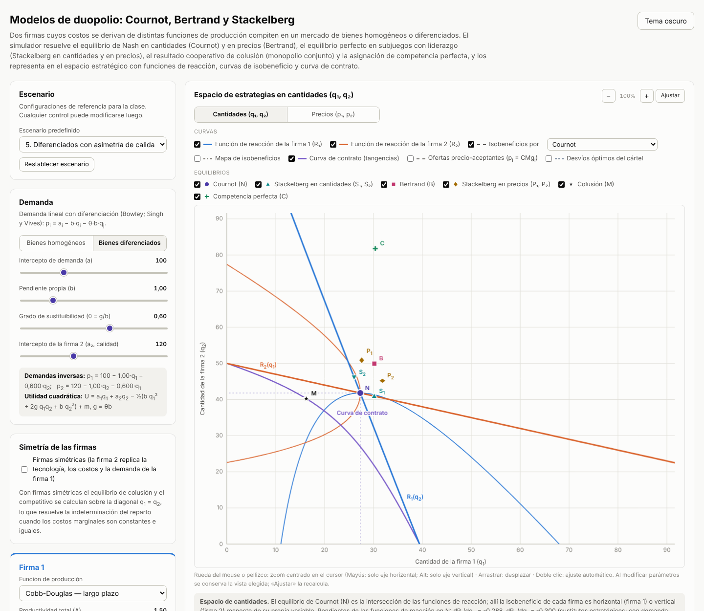
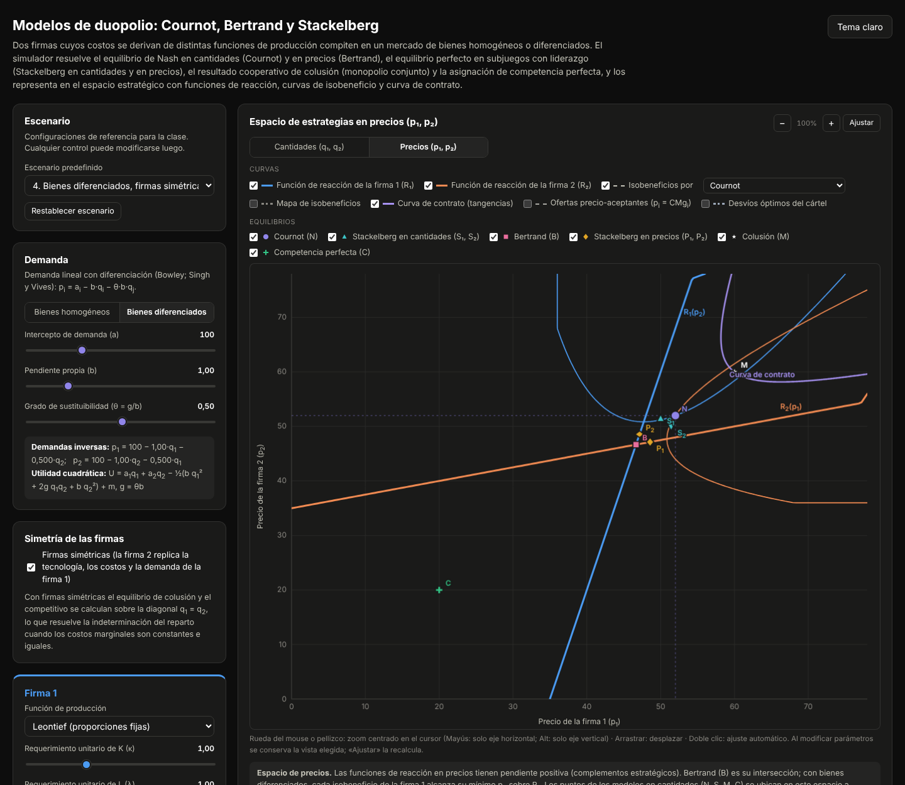

# Modelos de duopolio: Cournot, Bertrand y Stackelberg

Simulador interactivo, en un único archivo HTML autocontenido, de los modelos clásicos de **duopolio**. Dos firmas, cuyas funciones de costo se derivan de distintas funciones de producción, compiten en un mercado de bienes **homogéneos o diferenciados**, con firmas **simétricas o asimétricas**. El simulador resuelve y compara el equilibrio de Nash en cantidades (Cournot) y en precios (Bertrand), el equilibrio perfecto en subjuegos con liderazgo (Stackelberg en cantidades y en precios), el resultado cooperativo de **colusión** (monopolio conjunto) y la asignación de **competencia perfecta**, y los representa en el espacio estratégico con funciones de reacción, curvas de isobeneficio y curva de contrato. Material didáctico para Microeconomía Intermedia (Bloque 3: Estructuras de mercado, Oligopolio; Bloque 5: Teoría de juegos).

**[▶ Abrir el simulador](https://fcontiggiani.github.io/modelos-duopolio/modelos_duopolio.html)**



<details>
<summary>Versión en tema oscuro (espacio de precios)</summary>



</details>

## Modelo económico

**Demanda.** Un consumidor representativo con utilidad cuadrática (Bowley; Singh y Vives, 1984)

```
U(q₁, q₂) = a₁q₁ + a₂q₂ − ½(b q₁² + 2g q₁q₂ + b q₂²) + m,     g = θ·b,  θ ∈ [0, 1]
```

genera las demandas inversas p<sub>i</sub> = a<sub>i</sub> − b q<sub>i</sub> − g q<sub>j</sub>. Con θ = 1 y a<sub>1</sub> = a<sub>2</sub> los bienes son homogéneos (P = a − bQ); con θ = 0 los mercados son independientes. Para θ < 1 las demandas directas son q<sub>i</sub> = [b(a<sub>i</sub> − p<sub>i</sub>) − g(a<sub>j</sub> − p<sub>j</sub>)]/(b² − g²), con tratamiento explícito de las esquinas en que una firma deja de vender. El intercepto a<sub>2</sub> ≠ a<sub>1</sub> introduce asimetría de calidad percibida.

**Funciones de costo.** Duales de min wL + rK s.a. f(K, L) = q, seleccionables por separado para cada firma:

| Tecnología | Función de producción | Función de costo |
|---|---|---|
| Leontief (LP) | q = mín(K/κ, L/λ) | C = F + (rκ + wλ)·q |
| Cobb-Douglas (LP) | q = A·K^α·L^β, ν = α + β ≤ 1 | C = F + ν·(q/A)^(1/ν)·(r/α)^(α/ν)·(w/β)^(β/ν) |
| Cobb-Douglas (CP) | q = A·K̄^α·L^β | C = r·K̄ + F + w·(q/(A·K̄^α))^(1/β) |
| Costo cuadrático | forma reducida | C = F + c·q + (d/2)·q² |

Los rendimientos crecientes a escala se excluyen deliberadamente (el control de β se acota a 1 − α): con CMg decreciente el beneficio deja de ser cóncavo en la variable propia, las funciones de reacción pueden ser discontinuas y el equilibrio puede no existir.

**Modelos resueltos.**

| Modelo | Condiciones de equilibrio |
|---|---|
| Cournot | ∂π<sub>i</sub>/∂q<sub>i</sub> = a<sub>i</sub> − 2b q<sub>i</sub> − g q<sub>j</sub> − CMg<sub>i</sub>(q<sub>i</sub>) = 0, i = 1, 2 |
| Stackelberg en cantidades (líder 1 o 2) | max<sub>q<sub>L</sub></sub> π<sub>L</sub>(q<sub>L</sub>, R<sub>j</sub>(q<sub>L</sub>)): tangencia de la isobeneficio del líder con R<sub>j</sub> |
| Bertrand, bienes diferenciados | q<sub>i</sub> − [p<sub>i</sub> − CMg<sub>i</sub>(q<sub>i</sub>)]·b/(b² − g²) = 0, i = 1, 2 |
| Bertrand, bien homogéneo | p = c con CMg iguales (paradoja de Bertrand); precio límite p = c<sub>2</sub> − ε o monopolio de la firma eficiente con CMg asimétricos |
| Stackelberg en precios (líder 1 o 2) | max<sub>p<sub>L</sub></sub> π<sub>L</sub>(p<sub>L</sub>, R<sub>j</sub>(p<sub>L</sub>)); solo con bienes diferenciados |
| Colusión (monopolio conjunto) | a<sub>i</sub> − 2b q<sub>i</sub> − 2g q<sub>j</sub> − CMg<sub>i</sub>(q<sub>i</sub>) = 0 |
| Competencia perfecta | p<sub>i</sub> = CMg<sub>i</sub>(q<sub>i</sub>) ⇔ max W = U(q) − C<sub>1</sub> − C<sub>2</sub> |

Para cada modelo se informan q<sub>1</sub>, q<sub>2</sub>, Q, p<sub>1</sub>, p<sub>2</sub>, π<sub>1</sub>, π<sub>2</sub>, Π, excedente del consumidor EC = ½(b q<sub>1</sub>² + 2g q<sub>1</sub>q<sub>2</sub> + b q<sub>2</sub>²), excedente total W, pérdida irrecuperable de eficiencia PIE = W<sup>C</sup> − W (respecto de competencia perfecta), índices de Lerner (p<sub>i</sub> − CMg<sub>i</sub>)/p<sub>i</sub> e índice HHI.

**Casos que se señalan explícitamente:**

- paradoja de Bertrand con CMg constantes e iguales;
- Bertrand con costos asimétricos: precio límite (equilibrio en estrategias débilmente dominadas) o monopolio no amenazado de la firma eficiente;
- Bertrand con bien homogéneo y **CMg creciente**: continuo de equilibrios con reparto igualitario o inexistencia en estrategias puras (Dastidar, 1995); se informa como referencia el resultado p = CMg, límite del Bertrand diferenciado cuando θ → 1;
- colusión con firmas asimétricas: el cártel eficiente concentra la producción en la firma de menor costo y no es aceptable sin transferencias laterales;
- mercados independientes (θ = 0): todos los modelos estratégicos coinciden con el monopolio de cada firma.

**Sostenibilidad de la colusión.** En el juego repetido con estrategias gatillo (reversión permanente al equilibrio de Nash del juego de etapa), la colusión es un equilibrio perfecto en subjuegos si

```
δ ≥ δ* = (πᴰ − πᴹ) / (πᴰ − πᴺ)
```

donde π<sup>D</sup> es el beneficio del desvío óptimo de un período frente a la estrategia colusiva de la rival. El simulador calcula δ* para cada firma con competencia en cantidades (castigo de Cournot) y en precios (castigo de Bertrand); en el caso simétrico de referencia reproduce δ* = 9/17 y δ* = 1/2.

## Controles

| Control | Rango | Efecto |
|---|---|---|
| Escenario predefinido | 6 escenarios | Homogéneo simétrico; asimetría de costos Leontief; CMg creciente (Cobb-Douglas CP); diferenciados simétricos; asimetría de calidad y de tecnología; sustitutos cercanos (θ = 0,95) |
| Tipo de bien | Homogéneos / diferenciados | Fija θ = 1 o habilita el control de θ |
| Intercepto (a), pendiente (b) | 20–300, 0,2–4 | Desplazan y rotan la demanda |
| Grado de sustituibilidad θ = g/b | 0–0,98 | De mercados independientes a sustitutos casi perfectos |
| Intercepto de la firma 2 (a<sub>2</sub>) | 20–300 | Asimetría de calidad (solo diferenciados y asimétricas) |
| Firmas simétricas | Casilla | La firma 2 replica la tecnología de la firma 1; al desmarcarla, parte de esa configuración |
| Función de producción (por firma) | 4 tecnologías | Cada firma conserva los parámetros de cada tecnología al alternar |
| Parámetros tecnológicos (κ, λ, A, α, β, K̄, c, d, F) | Según tecnología | Desplazan y rotan el CMg y las funciones de reacción |
| Salario w y costo del capital r | 1–30 | Precios de los factores, comunes a ambas firmas |
| Espacio estratégico | Cantidades / precios | Cada espacio conserva su propia vista |
| Curvas | R<sub>1</sub>, R<sub>2</sub>, isobeneficios por un equilibrio elegido, mapa de isobeneficios, curva de contrato, ofertas precio-aceptantes p<sub>i</sub> = CMg<sub>i</sub>, desvíos óptimos del cártel | Muestran u ocultan cada elemento |
| Equilibrios | N, S<sub>1</sub>/S<sub>2</sub>, B, P<sub>1</sub>/P<sub>2</sub>, M, C | Muestran u ocultan cada punto; todos los modelos se ubican en ambos espacios mediante la demanda |
| Zoom y desplazamiento | Rueda, pellizco, arrastre, botones −/+ | Zoom centrado en el cursor; Mayús: solo eje horizontal; Alt: solo eje vertical; doble clic o «Ajustar» restablece la vista |
| Comparación entre modelos | Selector de variable | Barras de Q, precio medio, π<sub>1</sub>, π<sub>2</sub>, Π, EC, W, PIE o HHI |
| Tema claro/oscuro | Botón superior | Por defecto sigue la preferencia del sistema; la elección se recuerda |

Una sección plegable desarrolla la derivación analítica de cada equilibrio (CPO, CSO, funciones de reacción, efecto estratégico del líder, condición de sostenibilidad) con los valores vigentes.

## Sugerencias de uso en clase

1. **Escenario 1.** Ubicar N en la intersección de las funciones de reacción y verificar con las isobeneficio que S<sub>1</sub> es la tangencia con R<sub>2</sub>. Activar la curva de contrato y los desvíos del cártel: M es Pareto-eficiente para las firmas pero no es un equilibrio de Nash.
2. **Escenario 2.** Comparar Cournot con Bertrand ante costos asimétricos: precio límite, participación y Lerner de cada firma, y por qué el cártel eficiente necesita transferencias.
3. **Escenario 4, espacio de precios.** Contrastar complementos estratégicos (precios) con sustitutos estratégicos (cantidades) y la ventaja del segundo jugador en Stackelberg en precios.
4. **Escenario 6.** Llevar θ de 0,5 a 0,98 y observar cómo Bertrand converge al resultado competitivo mientras Cournot conserva márgenes positivos.
5. **Escenario 3.** Discutir por qué, con CMg creciente, Bertrand con bien homogéneo no tiene un equilibrio único.

## Requisitos técnicos

- Archivo único `modelos_duopolio.html` (HTML, CSS y JavaScript inline), sin bibliotecas externas ni CDN. Los gráficos usan Canvas 2D nativo.
- Funciona en cualquier navegador moderno con JavaScript habilitado, sin conexión una vez descargado.
- La preferencia de tema se guarda en `localStorage`, protegido con `try/catch` para entornos con restricciones (iframes de Moodle).
- Diseño adaptable: en pantallas angostas los controles se apilan sobre los gráficos y las tablas se desplazan horizontalmente.
- El motor matemático fue validado en Node.js (54 pruebas) contra las soluciones cerradas del caso lineal: Cournot, Stackelberg y colusión simétricos y asimétricos, Bertrand diferenciado y Stackelberg en precios, paradoja y precio límite de Bertrand, costos cuadráticos, dualidad de costos Cobb-Douglas frente a minimización numérica, CMg analítico frente a numérico, asimetría de calidad, θ = 0, curva de contrato y δ* = 9/17 y 1/2. Una prueba de estrés con 300 configuraciones aleatorias verifica que ningún modelo supera el bienestar competitivo ni el beneficio conjunto del cártel, y que el equilibrio de Cournot no admite desvíos unilaterales rentables.

## Referencias

- Varian, H. *Microeconomía intermedia*, cap. «Oligopolio» y «Teoría de juegos».
- Pindyck, R. y Rubinfeld, D. *Microeconomía*, cap. 12 y 13.
- Mas-Colell, A., Whinston, M. y Green, J. *Microeconomic Theory*, cap. 12.
- Singh, N. y Vives, X. (1984). Price and quantity competition in a differentiated duopoly. *RAND Journal of Economics*, 15(4), 546–554.
- Dastidar, K. G. (1995). On the existence of pure strategy Bertrand equilibrium. *Economic Theory*, 5(1), 19–32.
- Friedman, J. (1971). A non-cooperative equilibrium for supergames. *Review of Economic Studies*, 38(1), 1–12.

## Licencia y uso

Material desarrollado con fines exclusivamente didácticos. Los valores numéricos son ilustrativos. Se autoriza su uso, adaptación y redistribución con fines educativos, citando la fuente.
